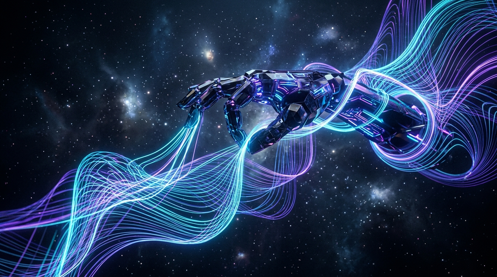

<!-- AI STUDIO CONCEPT COVER (NO TEXT) -->

  

# `UP STUDIO`
### AI Design Engineering • Creative Technologist

  
  &nbsp;
  
  &nbsp;
  

---

### 🍱 Core Stack & Focus

<table>
  <tr>
    <td width="50%" valign="top">
      <h4>🎨 Creative & 3D Craft</h4>
      

        🎯 <b>Brand Identity</b> — Design Systems & CIP 
        💎 <b>Marketplace Assets</b> — Print & Vector Graphics 
        🧊 <b>3D & Spatial</b> — Blender Environments & Shaders 
        🎬 <b>Generative Media</b> — Multimodal Visual Direction
      

    </td>
    <td width="50%" valign="top">
      <h4>⚡ Autonomous AI & Engineering</h4>
      

        🧠 <b>Neural Pipelines</b> — ComfyUI & Flux Workflows 
        🚀 <b>GPU Super-Res</b> — Real-ESRGAN Vulkan 4K/8K 
        🤖 <b>Agent Systems</b> — Autonomous Release & Tools 
        ⚙️ <b>Edge & Automation</b> — Python, TS & Batch Pipelines
      

    </td>
  </tr>
</table>

---

### 🐍 Contribution Activity Stream

<picture>
  <source media="(prefers-color-scheme: dark)" srcset="https://raw.githubusercontent.com/upstudiomn/upstudiomn/output/github-snake-dark.svg" />
  <source media="(prefers-color-scheme: light)" srcset="https://raw.githubusercontent.com/upstudiomn/upstudiomn/output/github-snake.svg" />
  
</picture>

---

### 🛠️ Production Technologies

  

---

### 📬 Connect & Collaborate

  
  &nbsp;&nbsp;
  
  &nbsp;&nbsp;
  

 

Crafted with precision by <b>UP Studio</b>

